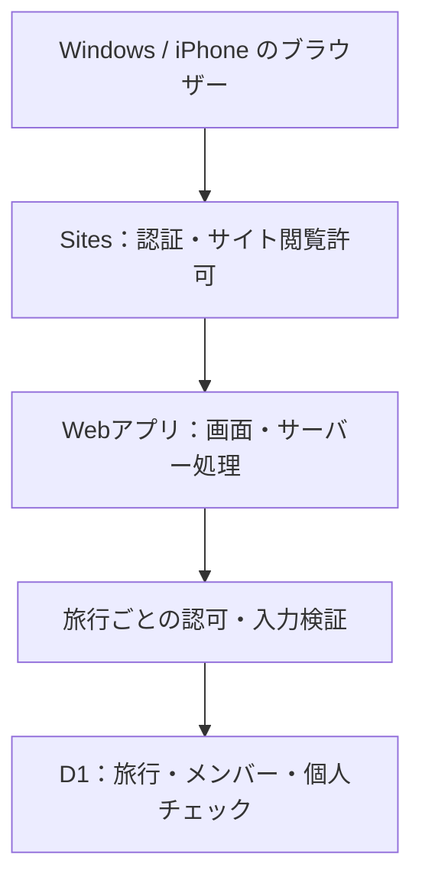
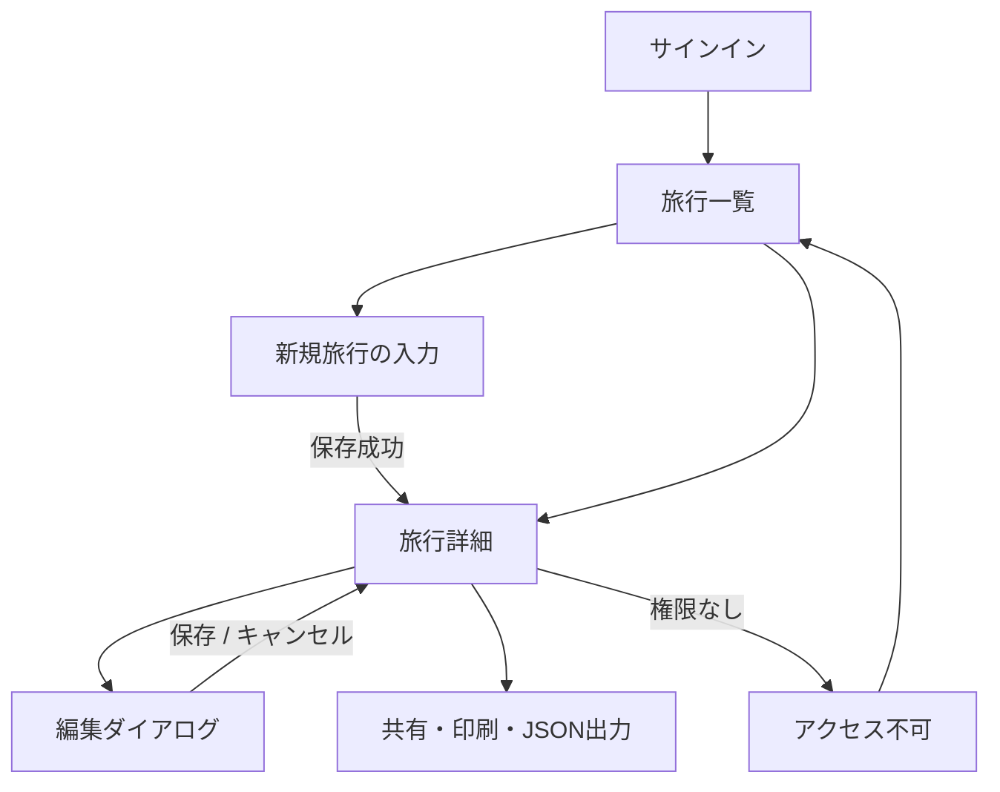
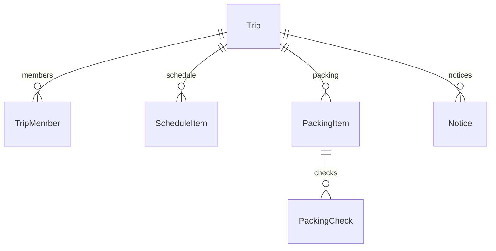

# 旅のしおり Webアプリケーション 基本設計書

版: 0.1（レビュー用）  
作成日: 2026-11-01  
工程: 基本設計  
状態: レビュー待ち。詳細設計・実装への着手前。

## 1. 位置付けと設計の前提

参照資料: [要件定義書](01-requirements.md)、[資料管理・レビュー運用](README.md)。要件定義書の初回登録は[PR #1](https://github.com/teruki487/travelers_guide/pull/1)でマージ済み。本書は機能の追加ではなく、要件を画面・権限・データ・処理に具体化する設計案である。

要件定義書に残る仮定は、今回の設計の前提として採用する。個別の未確定事項が解決済みであるとは扱わない。正式運用条件は第10章で管理する。先行試作のブラウザー内保存は本システムの保存方式に採用しない。

|設計ID|方針|理由・条件|
|---|---|---|
|BD-01|日本語・オンライン利用、Windows/iPhoneのChromeを対象|端末実機での動作確認は後工程|
|BD-02|幹事1名が旅行情報を編集、参加者は閲覧と自分のチェック|共同編集・所有権移管は対象外|
|BD-03|ChatGPTサインイン＋Sites閲覧許可＋旅行単位の認可|サイトへのアクセスと個別旅行へのアクセスを分離|
|BD-04|旅行データと準備チェックをD1に保存|同一利用者の端末間利用を可能にする|
|BD-05|手動更新で最新情報を取得|リアルタイム配信・通知は初期対象外|
|BD-06|旅行共有情報は版番号で競合検知、個人チェックは別管理|複数端末からの古い情報による上書きを防ぐ|
|BD-07|GitHub資料レビューとSites配置を別工程として管理|PRのマージだけではアプリを自動公開しない|

## 2. システム構成と責務

|層|担当する処理|担当しない処理|
|---|---|---|
|ブラウザー|入力、表示、タブ切替、確認ダイアログ、印刷・ファイル保存|権限の最終判断、共有データの正本保持|
|Sites|ChatGPTサインイン、サイト全体の閲覧許可、ホスティング|旅行ごとの幹事・参加者の判定|
|アプリのサーバー|認証情報取得、旅行認可、入力検証、競合制御、出力データ組立|独自のパスワード管理、メール配信|
|D1|旅行、閲覧者、日程、持ち物、お知らせ、チェックの永続保存|ブラウザー内データとの自動同期|

実装基盤はSites提供のVinext/Reactスターターとサーバー処理を用いる案とする。添付ファイルが初期対象外のためR2は使用しない。認証情報はSitesがサーバーへ渡す利用者ID・メールを使用し、クライアント申告のIDで認可しない。Sitesの認証ヘルパーと統合を維持する。

GitHubを公開してもアプリやD1の実データは公開しない。初回配置は本人限定で検証し、対象者を指定した後にSites側の閲覧者を追加する。Sites用ソースと公開GitHubリポジトリの同期・配置手順は詳細設計で決める。自動デプロイは本書では導入しない。

## 3. 利用者と権限

### 3.1 役割

- **運用者**: Sitesの所有者。サイト全体の閲覧許可を設定する。旅行の所有権とは別の役割。
- **幹事**: 旅行作成者。旅行内の共有情報と参加者登録を管理する。
- **参加者**: 旅行のメンバーとして登録された利用者。情報を閲覧し、自分の持ち物チェックを変更する。
- Sitesへアクセスできる利用者は自分の旅行を作成し、その旅行の幹事になれる。他の旅行では参加者となる場合がある。この扱いは設計上の提案としてレビュー対象とする。
- 運用者であっても、アプリ画面から他の幹事の旅行を無条件で閲覧する管理機能は設けない。基盤管理者が持つ運用上のアクセスとは区別する。

### 3.2 権限表

|操作|対象旅行の幹事|対象旅行の参加者|未登録者|
|---|---|---|---|
|一覧・詳細・日程・持ち物・お知らせ閲覧|可|可|不可|
|旅行情報・日程・持ち物項目・お知らせの編集/項目削除|可|不可|不可|
|参加者メールの追加・削除|可|不可|不可|
|参加者メールの一覧閲覧|可|不可|不可|
|幹事の表示名・人数の閲覧|可|可|不可|
|自分の準備チェック|可|可|不可|
|他人の準備チェック閲覧・変更|不可|不可|不可|
|共有URL取得・印刷・JSON出力|可|可|不可|
|Sites閲覧者の設定|Sites運用者がアプリ外で実施|不可|不可|

一覧取得、詳細取得、変更、チェック、出力の各サーバー処理で認可する。ボタンの非表示だけで制限しない。旅行IDを知っているだけではアクセスできない。

### 3.3 参加・解除の流れ

1. 幹事が参加者のChatGPTサインイン用メールを旅行へ登録する。
2. 運用者がSites側でその対象者に閲覧を許可する。旅行登録とSites許可は別操作であり、自動連携しない。
3. 必要な招待の受諾後、参加者が共有URLを開いてサインインする。Sitesが返す認証メールと登録メールを照合する。
4. 旅行のメンバー登録に利用者IDを紐付ける。以後は登録が存在すること、IDと登録メールの整合を確認する。メール変更時は幹事による登録見直しを必要とする。
5. 旅行から参加者を削除すると、以降のサーバー処理を拒否する。他の旅行の権限・Sites全体の許可は変更しない。
6. サイト全体から外す場合は、運用者がSites側でも許可を解除する。

メールは前後空白除去・小文字化を行う。別名アドレスの推測、ドット除去、プラス記号以降の除去は行わない。同一旅行の重複登録は拒否する。

**確認済みの基盤条件**: 2026-11-01時点の対象Siteでは、所有者による外部閲覧者の招待が可能な設定である。ただし別アカウントでの受諾・閲覧は未検証。Sitesの招待操作でプラットフォームのメールが送信される可能性がある。アプリ内の自動通知とは区別し、招待の実行は対象者指定後に行う。本工程では招待しない。

既に端末に表示した内容やダウンロード済みファイルを、権限解除で回収することはできない。権限エラー時には画面内の取得済み旅行データを消去する。

## 4. 画面基本設計

### 4.1 画面・機能一覧

|画面ID|画面/領域|主な表示・操作|要件|
|---|---|---|---|
|SC-01|旅行一覧|自分が幹事/参加者の旅行、期間、行先、新規作成|FR-01,05|
|SC-02|旅行概要|タイトル、行先、期間、集合案内、幹事、人数、更新日時、更新ボタン|FR-01,07|
|SC-03|日程タブ|日付切替、時刻順の予定、場所・補足、幹事の追加/編集/削除|FR-02|
|SC-04|持ち物タブ|分類、項目、個人チェック、準備済み数、幹事の項目管理|FR-03|
|SC-05|お知らせタブ|本文・更新日時、新しい更新から表示、幹事の追加/編集/削除|FR-04|
|SC-06|メンバータブ|幹事には登録メール・参加状態・削除。参加者には幹事と人数のみ|FR-05|
|SC-07|作成/編集ダイアログ|必要項目、入力エラー、保存・キャンセル|FR-01〜05,09|
|SC-08|共有/出力領域|旅行URLコピー、閲覧許可の説明、印刷、JSON出力|FR-06,08|
|SC-09|サインイン/アクセス不可/エラー|ログイン案内、再試行、一覧へ戻る|FR-09,NFR-01|

SC-02〜06は旅行詳細ページ内にまとめる。URL案は一覧 `/`、詳細 `/trips/{tripId}`。URLにメールや旅行本文を含めない。個人チェック以外の操作は保存ボタンで確定する。

### 4.2 遷移

### 4.3 入力項目の基本方針

|対象|必須項目|任意項目・制約|
|---|---|---|
|旅行|タイトル、行先、開始日、終了日|集合案内。開始日≤終了日|
|予定|日付、時刻、件名|場所、補足。日付は旅行期間内。時刻重複は許容|
|持ち物|名称、分類|同名項目は許容。IDで区別|
|お知らせ|本文|作成・更新時刻はサーバーで付与|
|参加者|メールアドレス|幹事自身と重複する登録は不要|

文字数、件数、JSONサイズ、入力形式の詳細は詳細設計で定義し、画面とサーバーで一致させる。空白のみの必須項目を拒否する。入力した文章はテキストとして表示し、HTMLとして実行しない。

旅行先の現地日付・時刻として保持し、自動で時差変換しない。作成/更新の記録日時はUTCで保存し、画面では日本時間と明示して表示する。複数タイムゾーンをまたぐ旅程の自動補正は対象外。

### 4.4 共通の表示・操作

- スマートフォンは1列表示、PCは一覧と補足領域を配置する。具体的な色・余白・画面部品は詳細設計で定義する。
- 空の旅行一覧は新規作成を案内。空の日程等は「未登録」を表示し、架空の予定を本番データとして自動作成しない。
- 読込中、未保存、保存中、保存済み、保存失敗を区別する。保存成功はサーバー応答後に表示する。
- 項目削除は対象名称を示して確認する。取消し操作で破壊的変更を行わない。
- 編集中の画面移動は未保存内容の破棄を確認する。通信失敗・競合時は入力を保持し、成功したように見せない。
- キーボード操作、入力ラベル、ダイアログのフォーカス移動、色だけに依存しない状態表示に対応する。
- 一覧へ戻る/更新で最新情報を取得する。他の端末で変更した内容の自動反映やバックグラウンド通知は行わない。

## 5. 論理データ設計

### 5.1 エンティティ

|データ|主要項目|関連・一意性|
|---|---|---|
|Trip（旅行）|旅行ID、幹事利用者ID、幹事表示名、タイトル、行先、開始/終了日、集合案内、共有情報版番号、作成/更新日時|幹事は1名|
|TripMember（参加者登録）|登録ID、旅行ID、正規化メール、紐付け利用者ID、登録日時|旅行＋メール一意。紐付け後は旅行＋利用者IDも一意|
|ScheduleItem（予定）|予定ID、旅行ID、日付、時刻、件名、場所、補足、並び順|旅行に属する|
|PackingItem（持ち物項目）|持ち物ID、旅行ID、名称、分類、並び順|旅行に属する|
|Notice（お知らせ）|お知らせID、旅行ID、本文、作成/更新日時|旅行に属する|
|PackingCheck（個人チェック）|旅行ID、持ち物ID、利用者ID、準備済み、版番号、更新日時|旅行＋持ち物＋利用者一意|

論理的には各データを分離する。未チェックの行がない場合は準備未完了・版番号0として扱う案とする。未チェックへ戻す場合も更新履歴の版番号を失わない。ユーザーが未参加の旅行にチェックを作れないよう、親項目と所属をサーバーで検証する。

利用者の正本はSitesの認証情報とし、パスワードを保存しない。幹事もチェックできるため、PackingCheckはTripMember行の存在だけに依存させず、幹事または有効な参加者であることを検証する。

### 5.2 整合性・保存単位

- 旅行の共有情報を変更する際は、旅行版番号の条件付き更新と対象データ更新を一つの原子的な保存単位にする。
- 期間変更で既存予定が範囲外になる場合は拒否し、該当予定の日付修正・削除を案内する。黙って予定を消さない。
- 持ち物削除時は紐付くチェックも同じ保存単位で削除する。名称/分類の変更ではチェックを保持する。
- 参加者削除時は紐付く個人チェックも削除する。再登録時は準備未完了から開始する案とする。旅行全体の削除機能とは区別する。
- 旅行と利用者の識別子には推測困難なIDを用いるが、IDの秘匿だけを権限管理にしない。
- 一覧は幹事ID・参加者ID/登録メール、日程は旅行ID＋日付、チェックは旅行ID＋利用者IDで取得する想定。物理テーブル、索引、SQL、更新の原子性を担保する具体的方法は詳細設計で確定する。
- D1を正本とし、ブラウザー保存は表示設定などの端末固有情報に限定する。別端末のローカル保存とのマージは行わない。

先行草案の旅行JSON一括保存は本書の確定事項ではない。本設計では権限と更新単位を明確にするためデータを分離し、物理実装は次工程でレビューする。

## 6. 主要処理とエラー設計

|処理|正常系|失敗時の扱い|
|---|---|---|
|旅行作成|認証→入力検証→作成者を幹事として保存→詳細へ|入力維持。二重送信防止。成否不明時の重複防止方式は詳細設計|
|一覧/詳細取得|認証→対象旅行の所属確認→必要なデータだけ取得|未認証はログイン案内、権限外は存在を区別しない404|
|共有情報編集|幹事認可→入力/版番号検証→原子的保存→新しい版で再表示|旧版は409。自動上書きせず再取得して再編集|
|準備チェック|所属と項目確認→自分のチェック版番号検証→保存|失敗表示と再試行。同一利用者の別端末競合も409|
|参加者の登録/削除|幹事認可→重複/整合性確認→保存|Sites権限設定の成功と混同しない|
|最新情報に更新|未保存の破棄確認→再取得→表示更新|通信失敗時は「最新情報を取得できません」と表示|
|共有URLコピー|権限確認済みの旅行URLをコピー|クリップボード不可なら選択可能なURLを表示|
|印刷/JSON出力|権限を再確認し最新情報を取得→出力|通信・認可失敗なら出力せず理由を案内|

個人チェックの変更では旅行共有情報の版番号を更新しない。他人のチェックの取得・変更APIは設けない。チェック保存中は同じ項目の多重操作を抑止する。

|区分|応答方針|利用者への案内|
|---|---|---|
|入力不正|400相当|該当欄と理由を示す|
|未認証|401相当|サインインし直す|
|閲覧できる旅行への編集権限なし|403相当|幹事のみ編集可能|
|存在しない/閲覧不可の旅行|404相当|旅行が見つからない、または閲覧できない|
|編集競合|409相当|別の更新があるため再読込して確認|
|DB/サーバー障害|5xx相当|保存/読込できない。時間を置いて再試行|
|通信不能|通信エラー|オフライン保存は行わず入力を画面に保持|

内部例外・SQL・個人情報をエラー本文へ出さない。更新系では同一オリジンの要求であることと認可を確認する。認証依存データを共有キャッシュへ保存しない。障害調査用ログは基盤の範囲で利用し、本文やメール・認証情報を出力しない。管理監査ログ機能は追加しない。

## 7. 印刷・退避設計

|出力|対象|除外|
|---|---|---|
|印刷|旅行概要、全日の日程、持ち物と自分のチェック、お知らせ、出力日時|操作ボタン、参加者メール、他人のチェック|
|JSON|形式版、出力日時、旅行概要、日程、持ち物、お知らせ、自分のチェック|認証情報、Sites内部識別子、参加者メール、他人のチェック|

幹事・参加者とも、閲覧可能な内容のみを出力する。JSONは旅行内容と自分の準備状況の退避用であり、参加者設定を含むシステム全体の完全バックアップではない。自動復元・インポートは対象外であることを出力時に表示する。ファイルは利用者が保存し、サーバーの公開領域へ置かない。印刷では全日程が出力されることを確認し、現在選択中の1日だけに限定しない。

## 8. 非機能・運用基本設計

- **性能**: 1旅行30名・予定100件・持ち物100件・お知らせ30件を初期検証目標とする。参加人数は幹事を含める案。正式上限・速度保証は未確定。一覧の取得件数制限・ページングは詳細設計で定義する。
- **対応端末**: Windows/iPhone Chromeで、一覧→詳細→入力→チェック→再読込を確認。印刷/ダウンロードは各端末の標準機能と連携し、実機検証する。
- **安全性**: パラメーター化したDB操作、サーバー側認可・入力検証、Reactのテキスト表示を基本とする。
- **データ変更**: DBスキーマ変更はマイグレーション管理。既存の適用済みマイグレーションを書き換えず追加する。
- **配置**: レビュー済みのソースからビルドし、本人限定で検証する。GithubのPRレビューとSitesの配置を追跡できるよう、対象コミット・Sitesバージョンを記録する。
- **復旧**: アプリ版を戻す際もDBが自動で戻ると考えず、互換性を確認する。JSON出力だけでDB全体を復元できるとは扱わない。
- **保存・削除**: 保存期間や運用者によるデータ削除依頼への対応は未確定。自動削除や自動バックアップを本書だけで導入しない。
- **外部依存**: 経路・天気・予約・決済等のAPIは利用しない。料金の確約はせず、正式運用前に利用条件を確認する。

## 9. 要件との対応・後工程の検証

|要件ID|設計箇所|後工程で確認すること|
|---|---|---|
|FR-01|SC-01/02/07、第5・6章|作成・基本情報編集・再取得、幹事の識別|
|FR-02|SC-03、第4.3・5.2節|追加/編集/削除、日付・時刻順、期間変更の整合性|
|FR-03|SC-04、第5・6章|他人のチェック分離、同一利用者の端末間共有|
|FR-04|SC-05、第5・6章|幹事のみ更新可能、参加者の再取得|
|FR-05|第3章、SC-06|未登録者の直接アクセス拒否、解除後の再アクセス拒否|
|FR-06|SC-08、第3.3・6章|URLコピーと代替表示、二段階のアクセス条件|
|FR-07|BD-04、第5章|D1への保存と端末を変えた再取得|
|FR-08|第7章|全日程印刷、JSON項目、個人情報の除外|
|FR-09|第4.4・6章|競合409、通信断時の入力保持、誤った成功表示の防止|
|NFR-01|第3・6章|各操作の認可、利用者ID偽装・他旅行IDの拒否|
|NFR-02|第4.3・6章|不正入力、HTML文字列、DB入力の安全な処理|
|NFR-03|第4章|狭幅、キーボード、入力ラベル、ダイアログ操作|
|NFR-04|第8章|想定規模での応答と操作感|
|NFR-05|BD-07、第8・10章|資料の履歴、要求追跡、配置版の識別|

本工程では要件14件の対応と文書内の整合を確認する。ブラウザー動作、DB保存、認可、競合、負荷、招待受諾は未検証であり、合格を意味しない。

## 10. レビュー事項・詳細設計への引継ぎ

### 10.1 基本設計で確認いただきたい点

|項目|本書の提案|
|---|---|
|旅行作成者|Sitesへのアクセスがある利用者は自分の旅行を作成できる|
|共有の方式|ChatGPTアカウント必須。Sites許可と旅行内登録を別々に行う|
|参加者情報|登録メールは幹事のみ表示。参加者は幹事・人数を確認|
|個人チェック|幹事を含め、他人の準備状態は閲覧しない|
|参加者解除|その旅行の個人チェックを削除し、再参加時は初期化|
|最新情報|手動更新。自動通知・リアルタイム同期は行わない|
|退避範囲|参加者メールを除く旅行内容と自分のチェック。完全復元用途ではない|

### 10.2 残課題

|ID|課題|解決する時点|
|---|---|---|
|OPEN-01|参加者が利用するChatGPTアカウントと登録メールを確認|共有対象の指定時|
|OPEN-02|Sitesの招待受諾からアプリの旅行閲覧までを別アカウントで実証|共有機能の実装・結合試験。運用開始前に必須|
|OPEN-03|保存期間、退会・旅行削除依頼、バックアップ・復旧の運用条件|正式運用前|
|OPEN-04|正式な人数・旅行数等の上限と費用許容額|正式運用前|
|OPEN-05|ChatGPTアカウントを持たない参加者への対応が必要か|必要になった場合は要件変更PR|
|OPEN-06|開発環境の依存導入・ネットワーク疎通、Sitesビルド・配置の再確認|実装前。過去の試作時の制約が未解消|
|OPEN-07|公開GitHubソースからSites配置ソースへの同期と版追跡|詳細設計|

次工程ではAPI仕様、入力上限、物理DB、索引、認証とメンバー紐付けの実装、競合更新の原子性、二重送信・成否不明時の再試行、画面部品とテストケースを定義する。未確定の運用条件を実装者の判断で確定しない。

本PRのレビュー用成果物は本書と資料一覧の更新のみ。次工程の資料作成・実装・デプロイは行わず、ユーザーのレビューと進行指示を待つ。

## 11. 改訂履歴

|版|日付|変更内容|
|---|---|---|
|0.1|2026-11-01|要件定義に対応する画面、権限、論理データ、主要処理、出力・運用の基本設計を作成。未確定事項と後工程の検証を明記。|
