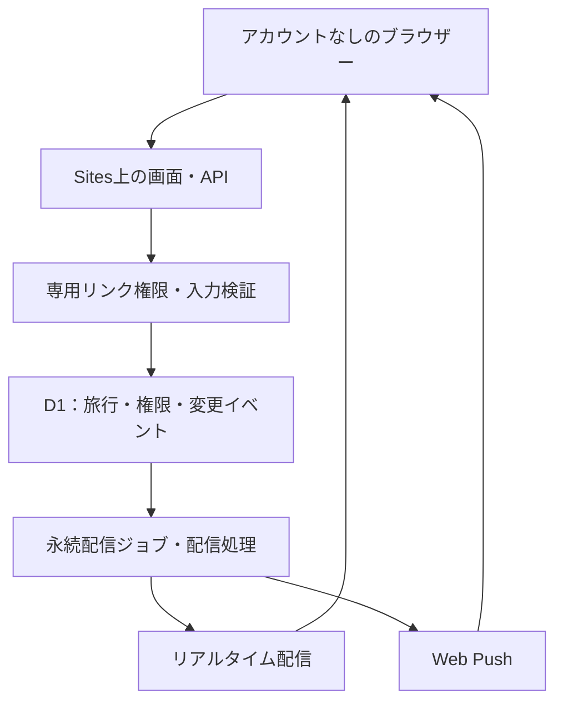
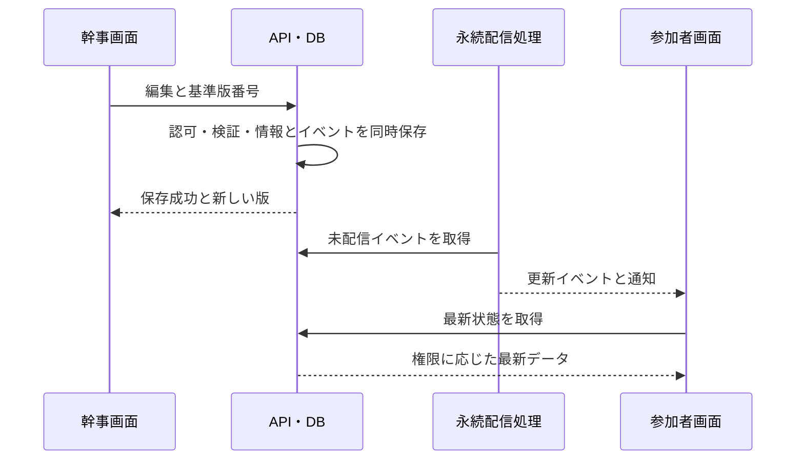

# 旅のしおり Webアプリケーション 基本設計書

版: 0.2（レビュー指摘反映・画面モック付き）  
作成・更新日: 2026-11-01  
工程: 基本設計  
状態: PR #2再レビュー待ち。実アプリの実装・公開設定変更は未実施。

## 1. 設計の前提と変更点

[要件定義書0.2](01-requirements.md)と[資料管理運用](README.md)を参照する。[変更対応表](review-response-02.md)にレビュー指摘との対応を記録する。

|設計ID|今回の方針|
|---|---|
|BD-01|日本語、オンライン、Windows/iPhone Chrome。PC・スマートフォンでレスポンシブ表示|
|BD-02|幹事用リンクに編集権限、参加者ごとのリンクに閲覧と本人チェック権限|
|BD-03|ChatGPTアカウントはSites管理者だけが利用。旅行の作成・編集・閲覧にはアカウント不要|
|BD-04|旅行データと個人チェックの正本はD1。ブラウザー表示と権限保持は分離|
|BD-05|共有情報の変更を自動通知し、接続中画面にリアルタイム反映|
|BD-06|旅行・個人チェックの版番号で競合検知。編集中の入力は保持|
|BD-07|本PRは資料とデザインモックのみ。マージと本番配置は別工程|

「アカウント不要」は「誰でも全旅行を閲覧・編集できる」を意味しない。編集/閲覧権限は秘密の専用リンクを所持することで付与する設計案である。人の身元は確認できないため、参加者表示名や人数は本人確認済み情報ではない。

## 2. システム構成

- 公開入口は旅行の作成案内のみを表示し、全旅行の公開一覧を置かない。
- Sites側を匿名訪問可能にする構成が必要。旅行API・配信・出力にはアプリ側の権限検証を必ず置く。公開GitHubと公開入口から旅行本文や秘密リンクを取得できない。
- Sites管理画面は引き続き管理者のChatGPTアカウントで管理する。通常の旅行利用者はSites招待・メール登録・ログインを必要としない。独自OAuthやパスワードアカウントは作らない。
- Vinext/ReactとD1を基本とする。添付ファイルがないためR2は不要。
- 同期はSSEを第一候補とする。共有状態の取得・変更はHTTP API、更新の到着はイベントで知らせる。単一Workerのメモリだけで全端末を接続管理しない。
- 変更イベントと配信待ちジョブを永続化し、全画面が閉じていてもジョブを処理できる配信基盤を必要とする。HTTP応答後の一時的処理だけに送信保証を依存させない。

**実現性の境界**: Cloudflare Workersのストリーム機能は確認済みだが、対象Sites経由でのSSE通過、接続の維持・権限解除、永続ジョブの実行基盤は未検証。Durable Objects・Queues等をSitesに自動追加できるとは仮定しない。詳細設計でSitesの対応機能を実証し、不足時はHTTP接続可能な外部配信基盤を選定して追加費用・運用条件をPRに記載する。機能を黙って手動更新へ縮小しない。

## 3. アカウント不要の権限設計

### 3.1 権限と専用リンク

|対象|できること|できないこと|
|---|---|---|
|サイト訪問者|アカウントなしの旅行作成|他の旅行の検索・閲覧|
|幹事用リンクの保持者|共有情報編集、参加者用リンクの発行・失効、自分のチェック|他参加者のチェック閲覧・変更|
|参加者用リンクの保持者|旅行閲覧、本人チェック、通知設定、印刷・JSON出力|共有情報編集、別参加者のチェック操作、幹事用リンク取得|
|無効/失効リンクの保持者|再共有依頼の案内を見る|旅行内容取得、イベント購読、チェック変更|
|Sites管理者|基盤・配置の運用|アプリでの無条件な全旅行閲覧機能は設けない|

幹事は1名分の権限を発行する。幹事用リンクを他者に渡すとその人も編集可能になるため、通常の共有ダイアログでは参加者リンクだけを表示する。幹事権限の再取得・再発行は独立した管理操作にする。

### 3.2 参加と端末間の引継ぎ

1. 旅行作成時に幹事権限を発行し、幹事用の復帰リンクを保存する案内を出す。本人確認用のメールは求めない。
2. 幹事が表示名を入力して参加者枠を作成し、その枠専用のリンクを発行する。
3. 幹事が普段の連絡手段で相手へリンクを渡す。本アプリは招待メールを送らない。
4. 参加者はリンクを開くだけで権限を取得する。表示名・アカウントを自称するだけでは権限を得られない。
5. 同じ専用リンクを別端末で使うと、同じ参加者枠のチェックと未読状態を引き継ぐ。新しい端末のPush許可は別途必要。
6. リンクを第三者へ転送すると、その第三者も同じ参加者として扱われる。秘密リンク方式の制約として共有画面で説明する。

専用リンクには暗号学的に十分な乱数を使い、推測可能な旅行IDだけでアクセスできないようにする。原本の秘密値をDBへそのまま保存せず、検証用ハッシュを保持する。トークンはURLフラグメントからHTTPS POSTで交換し、交換後にアドレス欄から消す案とする。権限セッションはSecure/HttpOnly/SameSiteを設定する案で、最終仕様は詳細設計でレビューする。

秘密リンク・セッション値は通知本文、アクセスログ、分析サービス、エクスポートに含めない。共有ページには第三者スクリプトを置かず、Referrer-Policyを設定する。リンク生成・権限交換・作成には濫用防止の回数制限を設ける。

### 3.3 失効・再発行

- 幹事が参加者を解除すると権限・セッション・イベント購読・Push送信先を失効し、その旅行の個人チェックを削除する。
- 同じ参加者枠のリンク再発行では旧リンクと既存セッションを失効するが、チェックは保持する。新リンクを相手に再共有する。
- 再接続時だけでなく、イベント配信・送信ジョブの実行直前にも権限を検査する。失効済み宛先には新規通知を出さない。
- 既に表示/保存/配信サービスへ引渡し済みの情報は回収できない。権限失効を検出した画面は旅行データを消去する。
- 全ての幹事リンク・有効セッションを失った場合は、身元照合による自動復旧ができない。復帰リンクの管理、有効期限、管理者による復旧条件は詳細設計の確認事項とする。

## 4. 自動通知とリアルタイム同期

### 4.1 対象と通知経路

|変更|同期対象|通知対象|
|---|---|---|
|日程・集合案内・旅行基本情報・持ち物項目・お知らせ|旅行の有効な全接続|その旅行の有効な参加者。更新者本人には保存結果を表示|
|参加者追加・解除・リンク再発行|権限に応じたメンバー表示。失効対象はアクセス終了|他参加者の個人情報を送らない。幹事への操作結果と対象者の状態表示|
|本人の準備チェック|同じ参加者枠の各端末のみ|他参加者へ通知しない|
|通知の既読・端末許可|同じ参加者枠の未読表示、対象端末の設定|全員向けの変更通知を生成しない|

- アプリ表示中は変更トースト・未読バッジ・通知一覧へ自動反映する。
- アプリを閉じている場合は、利用者が許可した対応端末へWeb Pushを送る。アカウントは不要で、権限とPush購読を紐付ける。
- OS通知を拒否・未設定・非対応でも旅行の閲覧編集は可能。アプリ内の通知は保持し、次回訪問時に未読を表示する。「端末通知なし」と分かる状態にする。
- Pushは「旅行のしおりが更新されました」等の最小限の内容にし、集合場所・参加者名・秘密リンクを含めない。タップ時はセッションを再検証して内容を取得する。
- 配信サービスへの受理と端末での表示、利用者の既読を区別する。OS都合・集中モード・圏外・許可設定で即時表示が保証されるとは表示しない。

iPhoneの閉画面通知はホーム画面に追加した対応Webアプリと通知許可を前提とする。Chromeの通常タブだけで同じ条件になるとは保証しない。通常タブでは画面内通知を利用し、対応端末にはホーム画面追加と通知設定を案内する。この条件はアカウント必須条件ではない。

### 4.2 保存から配信まで

- 保存成功時点で変更イベントと配信待ちを原子的に記録する。送信処理失敗を理由に保存済み情報を巻き戻さない。
- 旅行ごとに順序を持つイベントIDを付ける。受信側は重複を除外し、旧版を新しい版へ上書きしない。
- 配信は少なくとも1回を前提とし、ジョブ再試行時もイベントIDと宛先で重複を抑制する。通知一覧への重複登録を防ぐ。
- 端末切断後は最後に受信したIDから再取得する。保持範囲外なら最新スナップショットと未読一覧を取得する。
- 再試行は回数・間隔・失敗保留を管理し、Pushの無効購読は停止する。受信端末の存在に依存せず未送信処理を再開できる実行基盤を選ぶ。
- 編集中は更新受信を表示し、入力値を維持する。保存時の版番号不一致は409とし、差分確認・再読込を案内する。
- 初期目標は、正常接続中の保存完了から画面反映まで5秒以内（試験基準案）。実測前の保証値ではない。永続ジョブの遅延・同時接続・費用を詳細設計で検証する。

## 5. 画面基本設計とデザインモック

[仮デザインモック](mockups/travelers-guide.html)はダウンロードしてブラウザーで開く。GitHubのファイル画面ではHTMLを実行しない。[操作説明](mockups/README.md)を併読する。

|画面ID|画面・領域|主な内容|
|---|---|---|
|SC-01|入口・旅行一覧|アカウントなしで作成、この端末で利用した旅行。全旅行公開一覧ではない|
|SC-02|旅行概要|期間・行先・集合案内・役割・同期状態|
|SC-03|日程|日別タイムライン、幹事のみ追加/編集/削除|
|SC-04|持ち物|分類、本人のチェック・準備数、幹事の項目管理|
|SC-05|お知らせ|幹事の共有連絡。システム変更通知とは別タブ|
|SC-06|メンバー|幹事の参加者枠・専用リンク管理。参加者には幹事と人数|
|SC-07|作成・編集|入力ラベル、保存・キャンセル、競合時の入力保持|
|SC-08|共有・出力|参加者専用リンク、幹事用リンクの注意、印刷/JSON|
|SC-09|権限無効・接続切断|再共有依頼、再接続、再試行の案内|
|SC-10|変更通知・通知設定|未読、更新内容、通知対象へ移動、端末通知の案内|

モックはPC/スマートフォン、幹事/参加者、日程/持ち物/お知らせ/メンバー/通知、編集・共有ダイアログ、切断・失効・競合を確認できる。最上部の検証用バーを製品画面から分離し、架空データであると明示する。ロール切替はレビュー用であり、本番の権限切替機能ではない。

色は深緑と生成り、文字は日本語の読みやすさを優先する。スマートフォンは1列、操作は44px程度を目安とし、色だけで状態を表さない。編集ボタンは幹事にのみ表示する。画面内の「同期中」「更新しました」はモック内の疑似状態で、サーバー通信・実際の通知許可要求・Push送信は行わない。

日付は旅行先の現地時刻、記録時刻はUTC保存・日本時間表示。期間外予定は拒否し、期間変更で予定を無断削除しない。必須項目は旅行のタイトル/行先/期間、予定の日付/時刻/件名、持ち物の名称/分類、お知らせ本文、参加者枠の表示名とする。メールは不要。

## 6. 論理データ

|データ|主要項目・関係|
|---|---|
|Trip|旅行ID、期間・行先・集合案内、幹事枠ID、共有版番号、更新日時|
|Principal|旅行内の幹事/参加者枠ID、表示名、役割、有効状態。アカウントではない|
|AccessGrant / Session|枠ID、秘密リンクのハッシュ、期限、失効状態、セッションハッシュと期限|
|ScheduleItem / PackingItem / Notice|旅行ID、各項目、順序・更新日時|
|PackingCheck|枠ID＋持ち物ID一意、準備済み、個別版番号|
|ChangeEvent|旅行ID、順序付きID、対象、種別、共有版、通知範囲、発生時刻|
|Notification / ReadCursor|宛先枠、イベントID、未読/既読。宛先＋イベント一意|
|PushSubscription|枠ID、端末ID、購読情報、有効状態。第三者に返さない|
|DeliveryJob|イベントID、宛先、経路、試行数、次回試行時刻、配信結果|

権限情報、配信先、本人チェックを共有旅行レスポンスへ混ぜない。通知の閲覧時にも旅行・宛先権限を検証する。D1への変更とイベント/ジョブ登録は同じ保存単位。物理テーブル、トランザクション、索引、イベント保持期間、ジョブリースの詳細は次工程で確定する。

個人チェックの変更は共有版を進めず、同じ枠の端末間だけへ通知する。持ち物削除ではチェックも削除、名称変更はチェック保持。枠の解除とリンク再発行は第3.3節の差を守る。

## 7. 処理・障害・出力

|状況|動作|
|---|---|
|正常な編集保存|権限・入力・版を検証。共有情報とイベントを保存してから成功表示|
|保存中の追加操作|二重送信を抑止。再試行の重複防止キーを詳細設計|
|不正なリンク・セッション|旅行データを返さず、リンク再共有を案内。ログイン要求にしない|
|参加者による編集API操作|403。画面のボタン非表示だけに依存しない|
|存在しない/権限外の旅行|存在を推測できない404等の統一応答|
|競合409|入力保持、他の更新を案内、再取得して再編集|
|同期切断|「再接続中・表示が古い可能性」を表示し指数バックオフで再接続|
|接続復帰|最新状態と未読を自動補完。古いイベントで状態を戻さない|
|端末通知拒否・非対応|画面内通知は継続。設定説明を表示し許可を繰り返し要求しない|
|通知配信失敗|保存結果とは分離。永続ジョブを再試行し、失敗を運用で把握|

更新系の同一オリジン検証、CSRF対策、パラメーター化したSQL、安全な文字表示、共有キャッシュ禁止を行う。Push購読登録で任意URLへのサーバー送信を許さないよう、配送先の検証・リダイレクト制限・SSRF対策を詳細設計に含める。

印刷・JSONは出力時に権限を再確認し、最新の旅行概要・全日程・持ち物・本人チェック・お知らせを出力する。秘密リンク、セッション、参加者連絡先、他人チェック、Push購読は含めない。JSONは完全バックアップではなく、インポートは対象外。

## 8. 非機能と運用

初期試験目標は幹事込み30枠、予定100件、持ち物100件、お知らせ30件。通知数、同時接続、複数端末数、DB読取量、配信費用を追加の計測対象とする。レート制限の具体値は詳細設計で提示する。

公開入口の濫用対策と秘密リンクの権限検証が確認できるまで、実データを使う匿名公開は行わない。本レビューではSites公開範囲・設定・実通知先を変更しない。Web Push用秘密鍵はサーバーの秘密設定で管理し、GitHubやHTMLに埋め込まない。

復旧はアプリ版とDB互換性を確認する。保存期間、旅行削除、バックアップは未確定のまま管理する。通知イベント保存を全管理操作の監査ログ機能と混同しない。

## 9. 要件と検証の対応

|要件|設計|後工程で確認すること|
|---|---|---|
|FR-01|第3・5・6章|アカウントなし作成、幹事権限保持|
|FR-02|SC-03、第5・7章|日程編集、期間整合性、他端末反映|
|FR-03|SC-04、第6章|本人チェックの分離・端末間反映|
|FR-04|SC-05、第4章|幹事連絡更新と変更通知|
|FR-05|第3章、SC-06|専用リンク、失効・再発行・直接API拒否|
|FR-06|第3.2章、SC-08|役割別リンク、秘密値の漏えい防止|
|FR-07|第6章|永続保存・別端末の同一枠引継ぎ|
|FR-08|第7章|全日程印刷・機密情報を除くJSON|
|FR-09|第7章|入力保持、409、重複保存防止|
|FR-10|第4章、SC-10|全有効宛先への自動通知、未読、許可拒否・配信再試行|
|FR-11|第4章|正常時自動反映、順序・重複・切断回復・競合|
|NFR-01|第3・7章|リンク権限、購読・API認可、失効の反映|
|NFR-02|第5・7章|入力検証、XSS/SQL/CSRF/SSRF対策|
|NFR-03|第5章|レスポンシブ、フォーカス、読み上げ、通知状態|
|NFR-04|第4.2・8章|反映遅延、同時接続と費用|
|NFR-05|第8・10章|要求追跡、配置・復旧記録|

## 10. 残課題と次工程

|ID|確認・具体化する内容|期限|
|---|---|---|
|OPEN-01|専用リンク・セッション期限、幹事復帰リンク紛失対応|詳細設計|
|OPEN-02|Sites経由SSE、永続配信ジョブ基盤、失効時切断、運用コストの実証|実装方式決定前。未検証のまま実現済みとしない|
|OPEN-03|保存期間、旅行削除、バックアップ・復旧|正式運用前|
|OPEN-04|規模上限、費用許容額、リアルタイム5秒目標の妥当性|詳細設計・性能試験|
|OPEN-05|iPhoneホーム画面追加・Pushの動作、通知許可の説明|詳細設計・実機試験|
|OPEN-06|開発依存導入とSites配置環境|実装前|
|OPEN-07|GitHubからSitesへの同期・版追跡|詳細設計|

個人ごとのリンク方式、閉画面時Web Push、5秒の目標は今回の要求を具体化する設計案としてレビュー対象とする。ユーザーの指示（アカウント不要、自動通知、リアルタイム同期）そのものを保留や将来対応に戻さない。

モックは見た目・操作・状態の確認用であり、実際のリアルタイム通信、認可、DB、Pushの実装・試験を代替しない。レビュー指摘の修正を同じPRに追加し、マージ・次工程着手はユーザーの判断を待つ。

## 11. 変更履歴・技術参考

|版|日付|変更|
|---|---|---|
|0.1|2026-11-01|初回基本設計|
|0.2|2026-11-01|アカウント不要の専用リンク方式へ改訂。自動通知・リアルタイム同期・Web Pushの設計、画面モック、実現性確認事項を追加|

技術参考（2026-11-01確認）:
- [Cloudflare Workers Streams](https://developers.cloudflare.com/workers/runtime-apis/streams/): Workerのストリーム応答が可能。対象Sites経路での保証とは別。
- [WebKit: Web Push for Web Apps on iOS and iPadOS](https://webkit.org/blog/13878/web-push-for-web-apps-on-ios-and-ipados/): ホーム画面Webアプリ・利用者操作による許可という条件を確認。
- Sites提供の認証・保存ガイド: 公開Siteの匿名要求と、公開書込み処理に独自の認可が必要なことを確認。Sitesの管理者認証は維持する。
